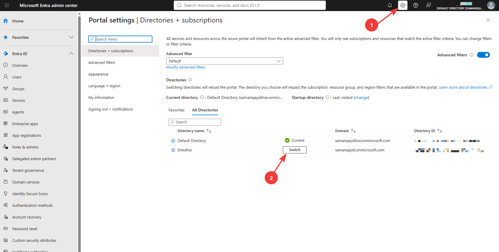
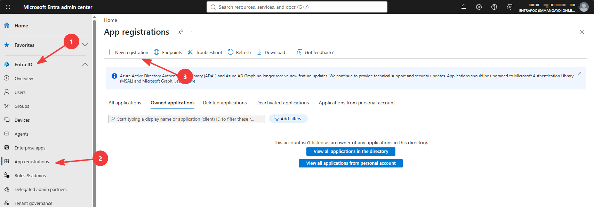
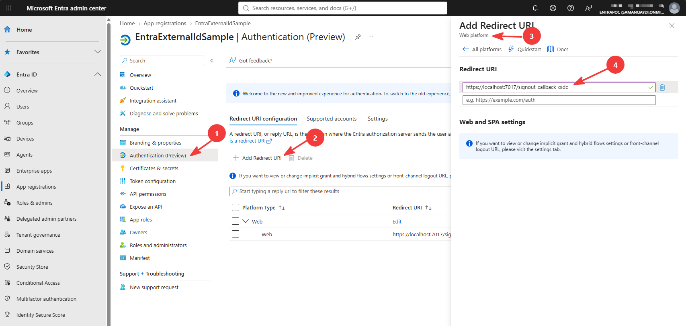
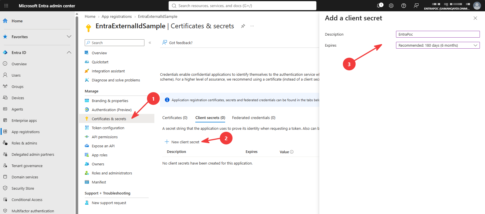
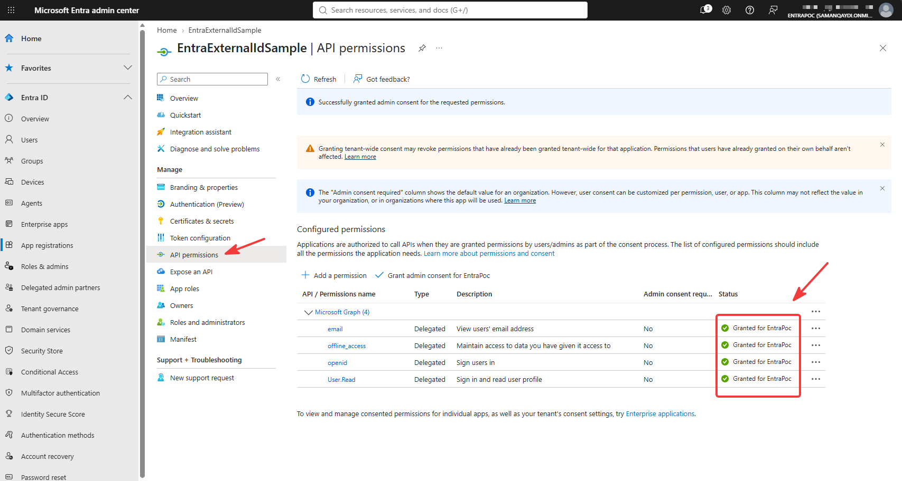

# Entra External ID + Blazor + PostgreSQL (POC)

Blazor Web App (.NET 10, interactive server) that signs users up / in through **Microsoft Entra External ID**
and records every signed-in user in a local PostgreSQL table.

| Piece | Where |
|---|---|
| OpenID Connect setup | `Program.cs` (Microsoft.Identity.Web, `AzureAd` section) |
| Sign-in / sign-up / sign-out endpoints | `Program.cs` → `/authentication/login`, `/authentication/signup`, `/authentication/logout` |
| Create/update the Postgres user row on each login | `OnTokenValidated` in `Program.cs` |
| Table definition | `Data/AppDbContext.cs` (table `Users`, created with `EnsureCreated` at startup) |
| Protected page showing claims + DB row + access codes from the `groups` claim | `Components/Pages/Profile.razor` |
| Access codes: mock codes/passwords, assign → Entra security group | `Services/AccessCodeService.cs`, `Services/GraphService.cs`, `Components/Pages/AccessCodes.razor` |
| Group-gated pages (policies `WarehouseA` / `WarehouseB`) | `Components/Pages/WarehouseA.razor`, `WarehouseB.razor`, policies in `Program.cs` |
| Home, sign-in/sign-up and access-denied pages | `Components/Pages/Home.razor`, `Login.razor`, `AccessDenied.razor` |
| Settings | `appsettings.json` has placeholders + the Postgres connection string; the real Entra values live in **.NET user secrets** (see part 5) |

Yes, you need **both** an External ID tenant **and** an app registration inside it. The guide below covers both.

---

## Azure setup, step by step

Six parts, in order: **(1)** Azure free account → **(2)** External ID tenant → **(3)** app registration → **(4)** user flow → **(5)** run the app → **(6)** groups for the access codes feature.
Everything is free for this POC: the free account charges nothing, and External ID is free up to 50k monthly active users.

### 1. Sign up for an Azure free account

An External ID tenant can only be created inside an Azure subscription, so this part is mandatory even though the service itself is free.
A credit card is required for identity verification; it is not charged unless you later upgrade to pay-as-you-go yourself.

1. Open <https://azure.microsoft.com/free> → **Start free**.
2. Sign in with your personal Microsoft account (or create one).
3. **Your profile**: country, name, email, phone → **Text me** / **Call me** and enter the verification code.
4. **Identity verification by card**: enter the card details → **Sign up**.
5. Accept the agreement. After a minute you land on <https://portal.azure.com>.
   Azure has now created a home tenant for your account called **Default Directory** and a subscription called **Azure subscription 1** (free trial: USD 200 credit for 30 days, then free-tier only; nothing is charged automatically).
6. If the portal asks you to set up **multifactor authentication**, complete it with the Microsoft Authenticator app. It is required for the admin account only; it does not affect your app's users.
   The page titled *Multifactor authentication (Phase 2)* is informational and needs no action.

### 2. Create the External ID tenant

1. Open <https://entra.microsoft.com> with the same account. You should land in **Default Directory**.
   If you see an *Interaction required / AADSTS16000* dialog, the portal is in the wrong directory: gear icon (top right) → **Switch directory** → **Default Directory**.
2. Click the **Manage tenants** shortcut on the home page (or left menu → **Entra ID** → **Overview** → tab **Manage tenants**) → **Create**.
3. Choose **External** → **Continue**.
4. Tab **Basics / Configuration**:
   - Tenant name: e.g. `EntraPoc`
   - Domain name: e.g. `entrapoc`  ← remember this. Your authority becomes `https://entrapoc.ciamlogin.com/`
   - Location: pick your region.
5. Tab **Add a subscription**: select **Azure subscription 1** and create a resource group, e.g. `rg-entra-poc`.
6. **Review + create** → **Create**. Takes 1–3 minutes.
7. Switch into the new tenant: gear icon → **Switch directory** → pick the new tenant (or use the link shown after creation). **Everything below happens inside this new tenant**, not in Default Directory.

### 3. Register the application

1. **Entra ID** → **Applications** → **App registrations** → **New registration**.

2. Name: `EntraExternalIdSample`.
3. Supported account types: leave the default (*Accounts in this organizational directory only*).
4. Redirect URI: platform **Web**, value `https://localhost:7017/signin-oidc`.
5. **Register**.
6. On the created **App Registration**, **Overview** page copy **Application (client) ID**. You will store it in user secrets in part 5.
7. **Authentication** → under Web redirect URIs **Add URI**: `https://localhost:7017/signout-callback-oidc` → **Save**.
   (Needed so Entra can send the browser back after sign-out.)

8. **Certificates & secrets** → **New client secret** → any description, 6 months → **Add** → copy the **Value** column now (it is shown once). You will store it in user secrets in part 5.

9. **API permissions** → **Add a permission** → **Microsoft Graph** → **Delegated** → tick `openid` and `offline_access` → **Add permissions** → then **Grant admin consent for <tenant>** → **Yes**.
10. **Token configuration** → **Add optional claim** → token type **ID** → tick `email` → in the pop-up tick **Turn on the Microsoft Graph email permission** → **Add**. (Puts the user's email in the ID token so it lands in the `Email` column.)
11. Back in **API permissions** a new `email` row appears without consent. Click **Grant admin consent for <tenant>** → **Yes** again so all rows show the green check.


### 4. Create the sign-up / sign-in user flow

1. **Entra ID** → **External Identities** → **User flows** → **New user flow**.
2. Name: `SignUpSignIn`.
3. Identity providers: **Email one-time passcode** (passwordless, what this sample uses) or **Email with password**.
4. User attributes: tick **Display Name** (Email is always collected).
5. **Create**.
6. Open the user flow you just created → **Applications** → **Add application** → select `EntraExternalIdSample` → **Select**.
   **Do not skip this** – without it sign-in fails with an AADSTS error saying the app is not associated with a user flow.

### 5. Configure and run the app

The Entra values are **not** stored in `appsettings.json` (it only has placeholders, so the repo can be public).
They go into [.NET user secrets](https://learn.microsoft.com/aspnet/core/security/app-secrets), a JSON file outside the repo
(`%APPDATA%\Microsoft\UserSecrets\<UserSecretsId>\secrets.json`) that ASP.NET Core loads automatically in the Development environment.
The `UserSecretsId` is already set in the `.csproj`.

Run these from the project folder, with your own values:

```powershell
dotnet user-secrets set "AzureAd:Authority"    "https://entrapoc.ciamlogin.com/"   # your domain name from step 2.4
dotnet user-secrets set "AzureAd:ClientId"     "<Application (client) ID from step 3.6>"
dotnet user-secrets set "AzureAd:ClientSecret" "<secret Value from step 3.8>"
dotnet user-secrets list                                                           # check
```

In Rider: right-click the project → **Tools** → **.NET User Secrets** opens the same file. In Visual Studio: right-click the project → **Manage User Secrets**.

Secrets override the placeholders in `appsettings.json` because user secrets are loaded after it. In production you would supply the same keys via environment variables (`AzureAd__ClientSecret`) or Key Vault instead.

PostgreSQL is expected on `localhost:5432`, user `postgres`, password `Aa@12345` (connection string in `appsettings.json`).
The database `entra_external_id_sample` and table `Users` are created automatically on first start.

```powershell
dotnet run --launch-profile https
```

Open <https://localhost:7017> → **Create account** (opens Entra's sign-up page directly) or **Sign in**.
After signing in, open **Profile** to see the ID-token claims and the row that was written to PostgreSQL.

Check the row directly:

```sql
SELECT * FROM "Users";
```

---

### 6. Enable the access codes feature (groups)

Two more settings on the same app registration (**Entra ID** → **App registrations** → `EntraExternalIdSample`). Without them the
**Access codes** page fails with a Graph `403` and the Warehouse pages always say access denied.

1. **Let the app manage groups.** **API permissions** → **Add a permission** → **Microsoft Graph** → **Application permissions**
   (not *Delegated* this time) → search `Group.ReadWrite.All` → tick it → **Add permissions**. Then **Grant admin consent for <tenant>** → **Yes**.
   The new row must show the green check and its **Type** column must say *Application*. This lets the app create security groups and
   add members with its own identity (client credentials), with no user signed in.
2. **Put groups into the token.** **Token configuration** → **Add groups claim** → tick **Security groups** → under **ID**, leave **Group ID**
   selected → **Add**. From now on every ID token carries the object ids of the user's groups as `groups` claims.

No groups need to be created by hand; the app creates `AccessCode-<code>` groups on demand.

## Access codes → Entra groups → page authorization

Demonstrates writing back to Entra after login and authorizing on the result. `AccessCodeService` holds ten mock codes
(`ADVCD01` … `ADVCD10`, plain passwords, all listed on the page).

On **Access codes**, enter a code + password:

1. The app verifies the pair in memory (mock "authentication" of the code).
2. `GraphService` gets an app-only token (client credentials against `https://<sub>.ciamlogin.com/<sub>.onmicrosoft.com/oauth2/v2.0/token`).
3. It finds or creates the security group `AccessCode-<code>` and adds the signed-in user (`oid`) as a member.
4. Nothing is stored locally; Entra is the source of truth.

On the **next sign-in** the ID token carries a `groups` claim per group (object ids). In `OnTokenValidated` the app resolves those ids
to group names with one Graph call and adds a readable `access_code` claim per matching code (e.g. `access_code = ADVCD01`).

Pages are then gated with ordinary authorization policies:

| Page | Policy | Requires |
|---|---|---|
| `/warehouse-a` | `WarehouseA` | claim `access_code = ADVCD01` (group `AccessCode-ADVCD01`) |
| `/warehouse-b` | `WarehouseB` | claim `access_code = ADVCD02` (group `AccessCode-ADVCD02`) |

Signed-in users without the claim land on `/access-denied` (cookie `AccessDeniedPath`); anonymous users are sent to sign in.
**Profile** lists the resolved codes and the raw ID token. Groups are created on demand; an ID token holds at most 200 group ids per user.

## Troubleshooting

| Symptom | Cause / fix |
|---|---|
| `AADSTS50011` redirect URI mismatch | Redirect URI in app registration must be exactly `https://localhost:7017/signin-oidc`. |
| Error saying the application is not associated with a user flow | Step 4.6: add the app to the user flow. |
| `AADSTS7000215` invalid client secret | Secret expired or you copied the *Secret ID* instead of the *Value*. |
| `Invalid URI: The hostname could not be parsed` on startup | `AzureAd:Authority` is still the placeholder: user secrets not set, or the app is not running in the Development environment. |
| "Create account" shows the sign-in page instead | `prompt=create` not honoured by the tenant; use the *No account? Create one* link on that page. |
| `Token request failed: 401` / Graph `403` on Access codes | Step 6.1 missing: `Group.ReadWrite.All` **application** permission with admin consent, or secret wrong. |
| Assigned a code but Profile shows no access codes / Warehouse page says access denied | Step 6.2 missing (groups claim), or you did not sign out and in again. |
| `Email` column is null | Step 3.10 (`email` optional claim) not done; `preferred_username` is used as fallback. |

## What was deliberately left out (POC)

- Secrets are in user secrets, which only works on the dev machine → Key Vault or environment variables for a deployed app.
- `EnsureCreated` instead of EF migrations → switch when the schema needs to evolve.
- No token refresh / Graph calls; the app only needs the ID token.
